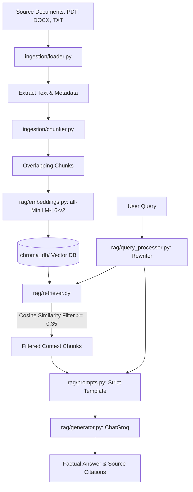

# CSE Capstone Project: Intelligent Knowledge Assistant using RAG

This is a polished, professional capstone project for B.Tech Computer Science and Engineering (CSE). It implements an **Intelligent Knowledge Assistant** using Retrieval-Augmented Generation (RAG) powered by LangChain, local HuggingFace embeddings (`all-MiniLM-L6-v2`), ChromaDB vector storage, and an open-source LLM via Groq API.

---

## 📖 Table of Contents
1. [Problem Statement](#problem-statement)
2. [Project Objective](#project-objective)
3. [RAG Architecture](#rag-architecture)
4. [Technologies Used](#technologies-used)
5. [Key Implementation Highlights](#key-implementation-highlights)
6. [Folder Structure](#folder-structure)
7. [Installation & Setup](#installation--setup)
8. [Configuration & Environment](#configuration--environment)
9. [How It Works](#how-it-works)
    - [Document Ingestion & Hash Checks](#1-document-ingestion--hash-checks)
    - [Vector Retrieval & Cosine Similarity](#2-vector-retrieval--cosine-similarity)
    - [Query Rewriting](#3-query-rewriting)
    - [Anti-Hallucination Guardrails](#4-anti-hallucination-guardrails)
10. [Automated Evaluation Dashboard](#evaluation-dashboard)
11. [Future Enhancements](#future-enhancements)

---

## 🚨 Problem Statement
Standard Large Language Models (LLMs) suffer from hallucinations (inventing facts, sources, and page numbers) when answering questions outside their training data. This is particularly problematic in enterprise settings or B.Tech presentations where strict factuality is mandatory.

## 🎯 Project Objective
To build a production-grade, document-grounded AI knowledge assistant that matches search requests to local context vectors, answers queries strictly using retrieved data, provides structured citations, refuses out-of-domain prompts, persists session chats, and manages vector DB index document lifecycle actions (e.g. previewing and deleting) in a premium user interface.

---

## 🏗️ RAG Architecture
Below is the system architecture block diagram:



---

## 🛠️ Technologies Used
- **Orchestration**: LangChain (Modular, standard-compliant layout)
- **Vector Database**: ChromaDB (with Cosine similarity space metric)
- **Local Embeddings**: `sentence-transformers/all-MiniLM-L6-v2` (384-dimensional vector space)
- **Inference API**: Groq Cloud SDK (Zero-temperature configuration)
- Language Models: `openai/gpt-oss-20b` (default, or custom selected model)
- **UI Framework**: Streamlit (Premium layout, Sidebar chat manager, Admin console toggle)
- **Document Processors**: PyPDF, Docx2txt

---

## ✨ Key Implementation Highlights
1. **Multi-Session Chat History**: Conversations are persisted locally in `chroma_db/chat_history.json` and are fully renameable and deletable without losing state during Streamlit reruns.
2. **Context-Aware Query Rewriting**: Pronouns and follow-up questions are resolved automatically via Llama query processing to allow back-and-forth conversational dialog.
3. **Advanced Chroma Manager Updates**: The system supports deleting individual documents from vector store indexes and clearing registries in parallel.
4. **Document Scoping**: Users can select "All Documents" or filter queries strictly to a single selected document.
5. **Secure Developer configuration toggle**: Streamlit sidebar is kept clean for general audience demonstrations, hiding parameters inside a toggleable Admin Panel.

---

## 📂 Folder Structure
```
project/
├── app.py                      # Streamlit UI dashboard
├── config.py                   # Central directory & environment configs
├── requirements.txt            # Python dependencies
├── .env                        # Local variables (API keys)
├── .env.example                # Example environment template
├── .gitignore                  # Git ignore config
├── README.md                   # Project documentation
├── data/                       # Source document files
├── chroma_db/                  # Local persistent Chroma vector database
├── ingestion/
│   ├── loader.py               # Reads PDF, TXT, DOCX files
│   ├── chunker.py              # Configurable splitting
│   └── document_manager.py     # Document status registry
├── rag/
│   ├── embeddings.py           # Wraps sentence-transformers models
│   ├── retriever.py            # Similarity search & scoping filters
│   ├── query_processor.py      # Conversation query rewriter
│   ├── prompts.py              # Strict RAG system prompt template
│   └── generator.py            # ChatGroq LLM connector
├── database/
│   └── chroma_manager.py       # Indices and deletes chroma documents
└── evaluation/
    ├── test_queries.json       # 15 preconfigured test cases
    └── evaluator.py            # RAG evaluator framework
```

---

## 🚀 Installation & Setup

1. **Install Dependencies**:
   ```bash
   pip install -r requirements.txt
   ```
2. **Configure Environment**:
   Create a `.env` file containing:
   ```env
   GROQ_API_KEY=your_groq_api_key_here
   ```
3. **Run streamlet application**:
   ```bash
   streamlit run app.py
   ```

---

## 🧪 Testing
Run the automated test suite to verify pipeline behaviors:
```bash
python tests/test_rag.py
```
Outputs should confirm 2 tests run successfully with status `OK`.
# Intelligent-Knowledge-Assistant
